<p align="center">
  <a href="https://nikobenzo.github.io/daily-challenge/">
    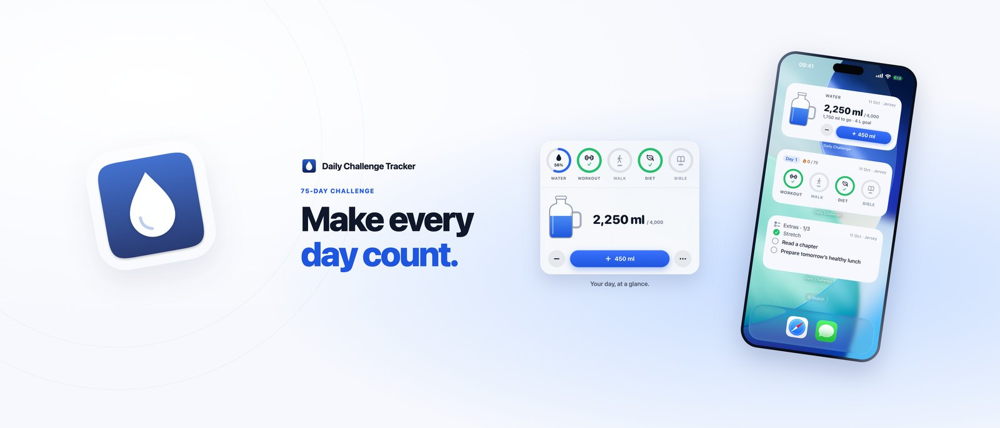
  </a>
</p>

<h1 align="center">Daily Challenge</h1>

<p align="center">
  <b>A calm, native tracker for your 75-day challenge.</b><br>
  Five daily goals, one tap each, in your Mac menu bar and on your iPhone. Keep the standard five or make them your own.
</p>

<p align="center">
  <a href="https://github.com/nikobenzo/daily-challenge/releases/latest"></a>
  
  
  
  
</p>

<p align="center">
  <a href="#install"><b>Install</b></a> ·
  <a href="#features"><b>Features</b></a> ·
  <a href="#screenshots"><b>Screenshots</b></a> ·
  <a href="#privacy"><b>Privacy</b></a> ·
  <a href="https://nikobenzo.github.io/daily-challenge/support.html"><b>Support</b></a>
</p>

<br>

Daily Challenge keeps a 75-day challenge simple. Every day you aim for five goals. The standard five are **four litres of water, a 45-minute workout, a 45-minute walk, a clean diet and Bible reading**, and you can make them your own: rename the activities, reading and diet, and set your own water goal and glass size. Tick each one off as you go, watch the water jug fill, and let the app keep count of your streak. Add a few personal extras on top if you like, and let them repeat. Your Mac and iPhone stay in sync through one account, and everything still works offline.

## Features

<table>
  <tr>
    <td width="50%" valign="top">
      <b>💧 Water you can see</b><br>
      A drawn jug fills with every <b>+</b> pour, 450 ml unless you change your glass size. Undo the last one or log a custom amount.
    </td>
    <td width="50%" valign="top">
      <b>✅ Five goals, one tap each</b><br>
      Workout, walk, diet and reading sit beside water as rings. A day is complete when all five are done.
    </td>
  </tr>
  <tr>
    <td valign="top">
      <b>🔥 Streaks and history</b><br>
      See your current and best streak, browse a calendar of completed days, and fix a past day on purpose with a clear edit mode.
    </td>
    <td valign="top">
      <b>📝 Extras that repeat</b><br>
      Add up to ten personal extras, such as stretching or journaling. Repeat them every day, on weekdays, on days you choose or every few days. They never affect your streak, and unfinished one-off extras carry over with a Late label.
    </td>
  </tr>
  <tr>
    <td valign="top">
      <b>🎯 Goals that are yours</b><br>
      Start with the standard five or rename the two activities, the reading and the diet, with an optional amount, unit and icon. Pick a preset such as yoga, Pilates, stretching or audiobook, or type your own. Set a water goal from 1 to 5 litres and your glass size, in setup or later from today. Earlier days keep the goals they had.
    </td>
    <td valign="top">
      <b>📅 The 75 days stay fixed</b><br>
      Whatever you choose, there are always five goals, every one has to be met for a day to count, and a missed day restarts your streak.
    </td>
  </tr>
  <tr>
    <td valign="top">
      <b>📱 Home Screen widgets</b><br>
      Log water, tick goals under their own names and check extras straight from the Home Screen, even with the app closed or offline. A water ring is available on the Lock Screen.
    </td>
    <td valign="top">
      <b>🔄 Mac and iPhone in sync</b><br>
      One account keeps both devices up to date. Entries save on the device first and upload when a connection returns.
    </td>
  </tr>
  <tr>
    <td valign="top">
      <b>🔔 Gentle water reminders</b><br>
      Optional reminders at an interval and daily window you choose. They stop once you reach your water goal.
    </td>
    <td valign="top">
      <b>🌗 Feels at home</b><br>
      Native SwiftUI in light and dark, with VoiceOver labels and Reduce Motion support. On the Mac it lives in the menu bar, with no Dock icon.
    </td>
  </tr>
</table>

## Screenshots

### iPhone

<p align="center">
  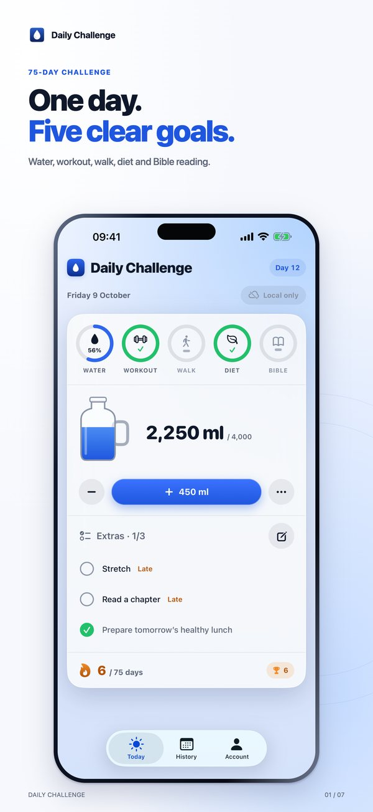
  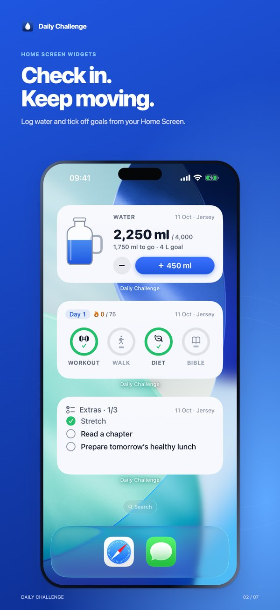
  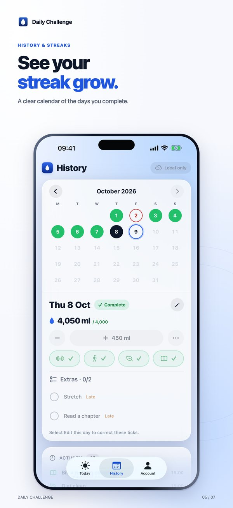
  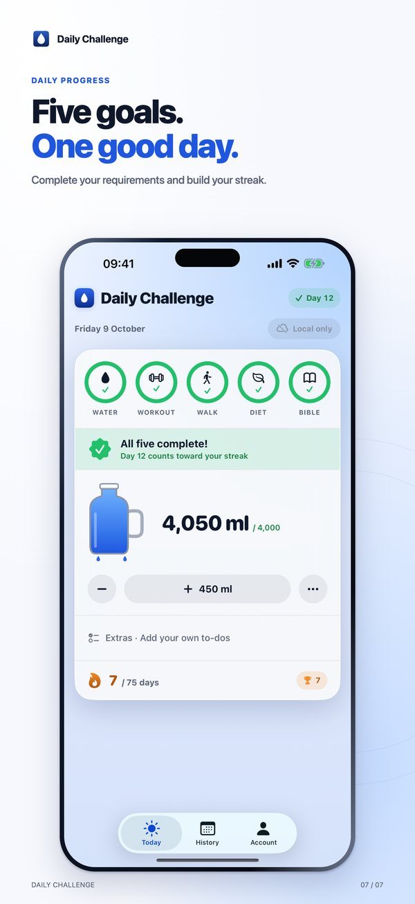
</p>

<details>
<summary><b>More iPhone screenshots</b></summary>
<br>
<p align="center">
  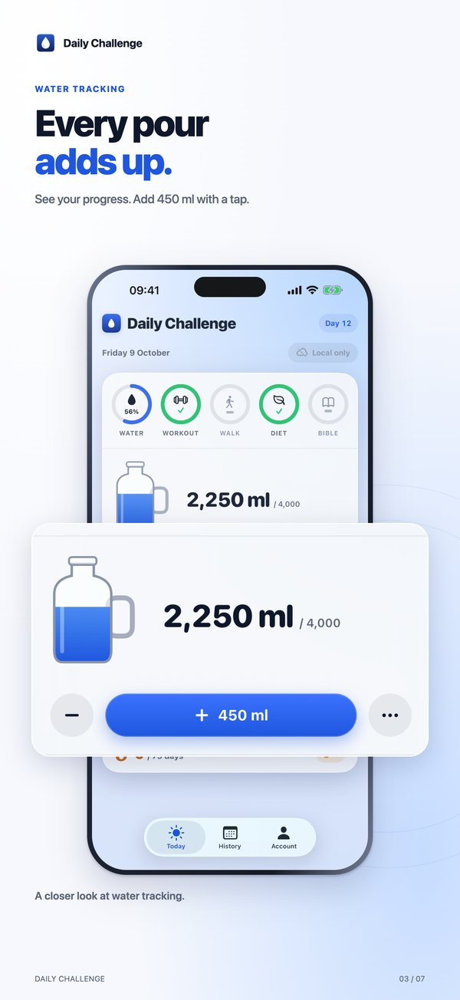
  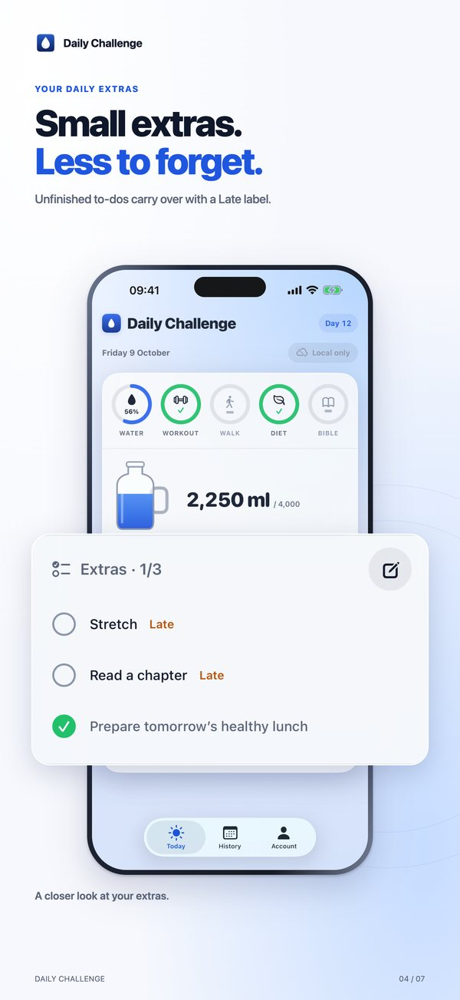
  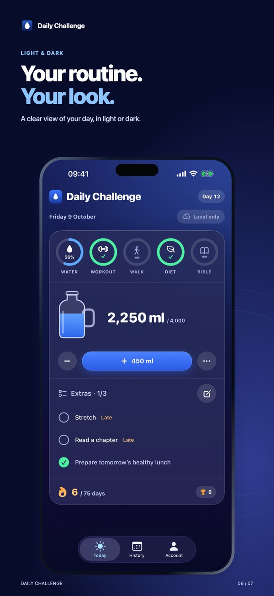
</p>
</details>

### Mac menu bar

Click the drop icon in the menu bar and your day is right there. These images follow your GitHub light or dark theme.

<p align="center">
  <picture>
    <source media="(prefers-color-scheme: dark)" srcset="docs/assets/mac/today-extras-dark.png">
    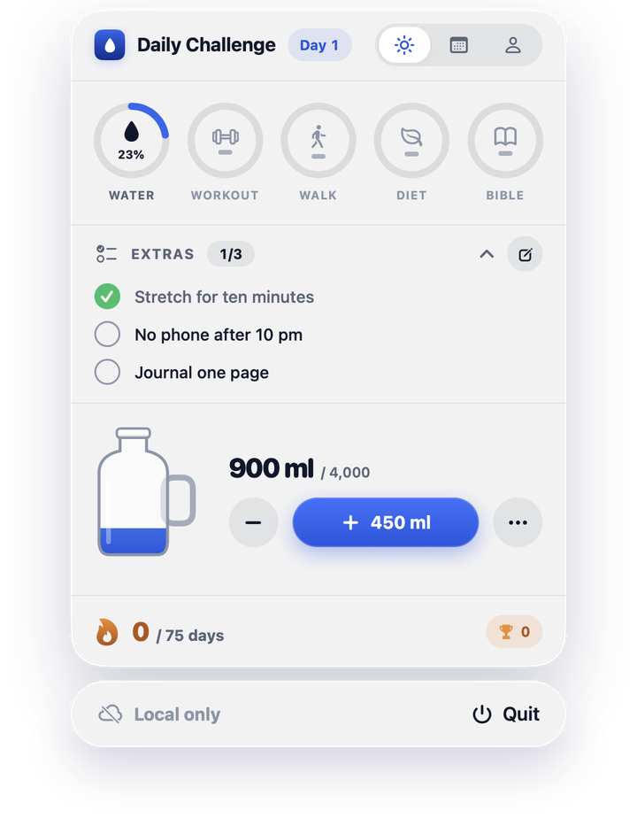
  </picture>
  <picture>
    <source media="(prefers-color-scheme: dark)" srcset="docs/assets/mac/history-dark.png">
    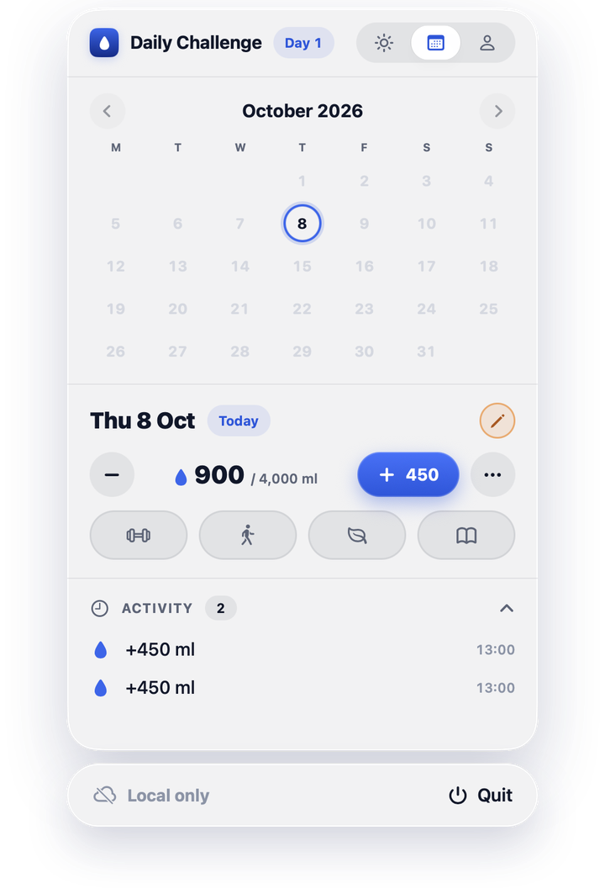
  </picture>
</p>

## Install

### Mac

Open Terminal and paste:

```sh
curl -fsSL https://nikobenzo.github.io/daily-challenge/install.sh | bash
```

The script downloads the [latest release](https://github.com/nikobenzo/daily-challenge/releases/latest), checks that it is signed by the developer and notarized by Apple, moves it to Applications and opens it. Nothing is installed if a check fails. You can read the script first in [`site/install.sh`](site/install.sh).

<details>
<summary><b>Prefer to install by hand?</b></summary>
<br>

1. Download the zip from the [latest release](https://github.com/nikobenzo/daily-challenge/releases/latest).
2. Unzip it and drag **Daily Challenge** to Applications.
3. Open it. A welcome window shows the first steps; after that, click the drop icon in the menu bar.

</details>

Requires macOS 14 or newer on an Apple silicon Mac. The app updates itself, so you only install it once.

### iPhone

**Coming soon to the App Store** as *Daily Challenge Tracker*. It needs iOS 26 or newer.

## Privacy

Daily Challenge collects only what it needs to show your progress and sync it between your devices.

- **No ads, no tracking and no analytics.** There are no third-party SDKs that collect usage data.
- **Your data stays yours.** Your account email and challenge entries are stored with Supabase, and each row can only be read by your own signed-in account.
- **Settings stay on the device.** Reminder times and appearance are never sent anywhere.
- **Delete any time.** Delete your account in the iPhone app, or email us, and your data is removed from the server.

Read the full [privacy policy](https://nikobenzo.github.io/daily-challenge/privacy.html).

## Support

Found a bug or have a question? Email **[yakovetskyi@icloud.com](mailto:yakovetskyi@icloud.com)** and mention your device and app version, or browse the [support page](https://nikobenzo.github.io/daily-challenge/support.html) for common questions. Please report security issues privately as described in [SECURITY.md](SECURITY.md).

## Build from source

Daily Challenge is written in Swift 6 and SwiftUI. The Mac app and the iPhone app share one core library for the challenge rules, storage and sync.

```sh
git clone https://github.com/nikobenzo/daily-challenge.git
cd daily-challenge
swift test
```

<details>
<summary><b>What is inside</b></summary>
<br>

| Area | Built with |
| --- | --- |
| Mac app | SwiftUI and AppKit menu bar popup, Sparkle 2 updates |
| iPhone app | SwiftUI, WidgetKit and App Intents widgets |
| Shared core | Challenge rules, local-first storage and sync in Swift packages |
| Backend | Supabase Postgres and Auth with row-level security |
| Install | Developer ID signed, notarized, installed by a small shell script |

</details>

A working signed build needs your own Supabase project and signing setup. The [developer guide](docs/DEVELOPMENT.md) covers configuration, building, testing and releases in full.

## About

Daily Challenge is a personal project by Mykola Yakovetskyi, built to make a 75-day challenge easier to keep. It is not seeking outside contributions; see [CONTRIBUTING.md](CONTRIBUTING.md) for how to report problems.

If Daily Challenge helps you, you can [buy me a coffee](https://buymeacoffee.com/mykoladev). It is entirely optional.

<a href="https://buymeacoffee.com/mykoladev">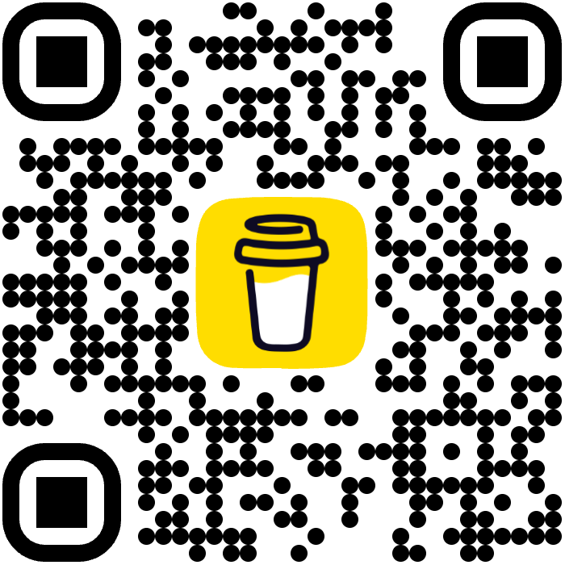</a>
